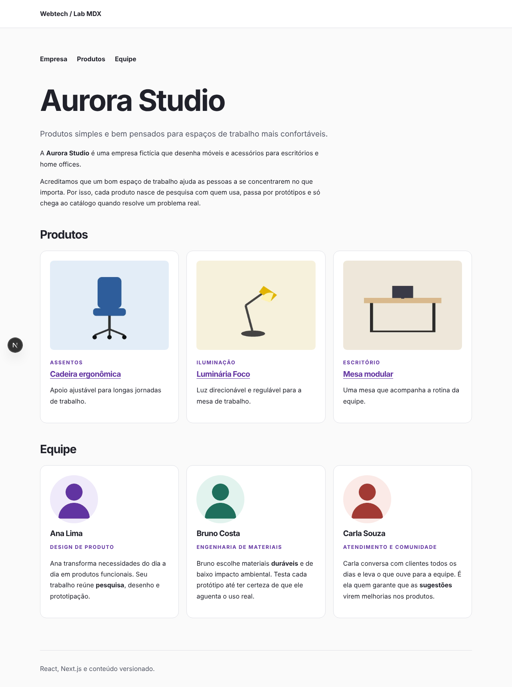
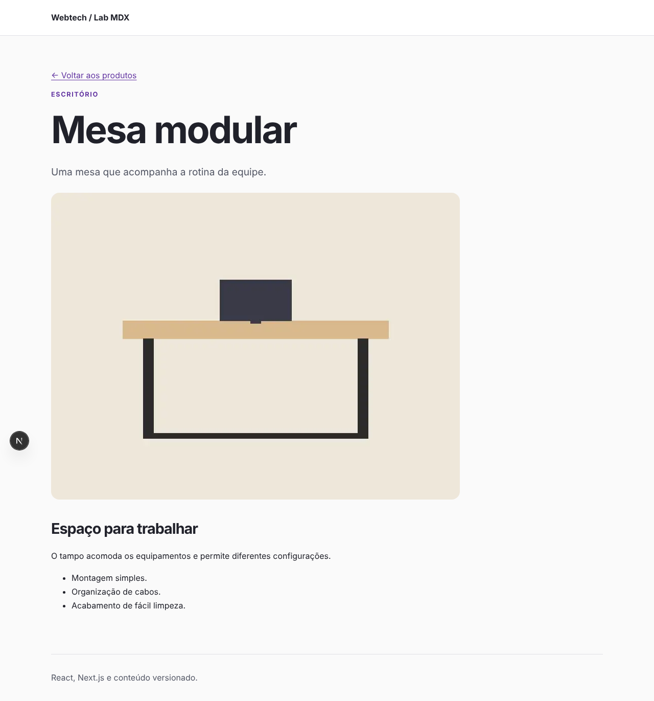
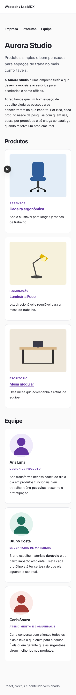
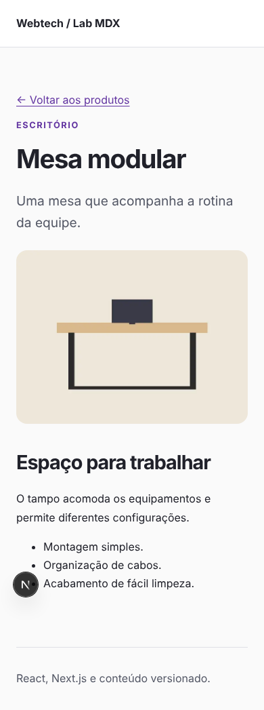

# Entrega — Aurora Studio

Página institucional da empresa fictícia **Aurora Studio**, com produtos e equipe carregados de arquivos MDX.

## Como executar

```bash
npm ci
npm run dev        # http://localhost:3000
```

Verificação completa e produção local:

```bash
npm run check      # lint + testes do leitor + build
npm start
```

## O que foi feito

| Arquivo | Papel |
| --- | --- |
| `cms/estrutura.json` | Coleções `paginas`, `produtos` e `equipe`, com todos os campos e `body` como `markdown` |
| `content/paginas/empresa.mdx` | Apresentação da empresa (`title`, `lead` e corpo) |
| `content/produtos/*.mdx` | Um documento por produto (`name`, `category`, `description`, `image`, `alt` e corpo) |
| `content/equipe/*.mdx` | Um documento por pessoa (`name`, `position`, `image`, `alt` e biografia no corpo) |
| `public/images/<coleção>/<slug>/` | Imagens dos documentos, acessadas como `/images/<coleção>/<slug>/<arquivo>` |
| `components/ProductCard.js` | Card de produto: recebe os dados por props e leva a `/produtos/<slug>` |
| `components/TeamCard.js` | Card de integrante: recebe os dados por props e renderiza a biografia com `EditorialContent` |
| `app/page.js` | Home: navegação por âncoras, empresa, produtos e equipe |
| `app/produtos/[slug]/page.js` | Detalhe do produto: título, imagem, corpo MDX, metadados e 404 |

Estados especiais:

- Coleção vazia: a home mostra “Nenhum produto cadastrado.” ou “Nenhum integrante cadastrado.”.
- Sem `empresa.mdx`: a home continua funcionando e mostra o título “Apresentação indisponível” com a orientação de criar o arquivo.
- Slug de produto inexistente: `notFound()` mostra a página 404.

## Caminho do conteúdo, do arquivo até a tela

1. O autor cria ou edita `content/produtos/mesa-modular.mdx` (no Webtech Editor ou diretamente no repositório).
2. A home (Server Component) chama `listContent("produtos")`. O leitor (`lib/content.mjs`) confere a coleção em `cms/estrutura.json`, lista os `.mdx` da pasta e usa `gray-matter` para separar o **frontmatter** do **corpo**.
3. Para cada documento, `ProductCard` recebe `slug` e os campos do frontmatter por props; o `slug` é a `key` da lista e forma o link `/produtos/<slug>`.
4. Em `/produtos/mesa-modular`, a rota `[slug]` chama `getContent("produtos", "mesa-modular")` e entrega o corpo a `EditorialContent`, que o renderiza com `MDXRemote` no servidor.
5. A equipe segue o mesmo caminho: o frontmatter vai para `TeamCard` e o corpo vira a biografia.

## Resultados das verificações

- `npm run check`: lint sem erros nem avisos, **6/6 testes** passando e build concluído (rotas `/`, `/paginas/[slug]` e `/produtos/[slug]` pré-renderizadas).
- `/produtos/mesa-modular` → 200; `/produtos/nao-existe` → 404; `/images/equipe/ana-lima/retrato.webp` → 200.
- Largura do documento: 390 px a 390 px e 1280 px a 1280 px (sem rolagem horizontal).
- Nenhuma imagem sem `alt`; todos os links são elementos `<a>` nativos, acessíveis por teclado (o layout já tem o link “Pular para o conteúdo” e foco visível).

**Teste decisivo (com `npm run dev` aberto):**

1. Criei `content/produtos/estante-leve.mdx` e `content/equipe/diego-alves.mdx`, sem alterar código. Ao recarregar a página, os dois apareceram.
2. Mudei o nome (“Diego Alves” → “Diego Ramos”) e a biografia no MDX. As mudanças apareceram.
3. Apaguei os dois arquivos. As entradas sumiram da home.

## Capturas de tela

| Home (desktop, 1280 px) | Produto (desktop) |
| --- | --- |
|  |  |

| Home (celular, 390 px) | Produto (celular) |
| --- | --- |
|  |  |

## Respostas

**1. O que o `estrutura.json` controla e o que precisa ser implementado em React/Next.js?**
Ele cadastra as coleções (id, nome, pasta, extensão) e os campos que o Webtech Editor mostra para edição. O leitor também o usa para validar a coleção. Ele não cria rotas, páginas nem componentes: exibir um campo exige que um componente React leia esse valor, e cada nova rota (como `/produtos/[slug]`) precisa ser criada no Next.js.

**2. Qual a diferença entre coleção, slug, rota e pasta de imagens?**
A coleção agrupa documentos do mesmo tipo (`produtos`, em `content/produtos`). O slug identifica um documento dentro dela (`mesa-modular`, o nome do arquivo sem `.mdx`). A rota é o endereço da aplicação que exibe o documento (`/produtos/mesa-modular`, definida por `app/produtos/[slug]`). A pasta de imagens guarda os arquivos públicos do documento (`public/images/produtos/mesa-modular/`, servidos em `/images/produtos/mesa-modular/...`).

**3. Como o frontmatter difere do corpo MDX?**
O frontmatter é o bloco YAML entre `---`, com dados estruturados (nome, categoria, imagem, alt) usados em cards, listas e metadados. O corpo é o texto em Markdown depois dele, renderizado como conteúdo editorial (descrição detalhada, biografia).

**4. Por que a leitura e a renderização ficam no servidor?**
A leitura usa o sistema de arquivos (`node:fs`), que não existe no navegador. Compilar o MDX no servidor também evita enviar o parser e o conteúdo bruto ao cliente, gera HTML pronto (mais rápido e melhor para SEO) e permite pré-renderizar as páginas no build. O `server-only` impede que o leitor seja importado por engano em um componente cliente.

**5. O que acontece entre salvar no editor e ver a alteração no site publicado?**
Salvar guarda um rascunho no IndexedDB do navegador. Publicar envia as alterações para a branch padrão do repositório no GitHub. Depois, é preciso um novo build/deploy da aplicação para que as páginas sejam geradas com o conteúdo novo. Só então a alteração aparece no site publicado.
